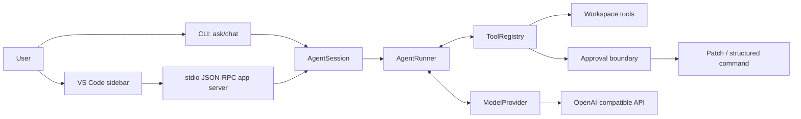

# OpenCodeAgent: Workflow और Codebase Guide

यह document repository को समझने के लिए entry point है। इसे इस क्रम में पढ़ें:

1. इस पेज का end-to-end flow
2. [agent loop](agent-loop.md), [workspace tools](workspace-tools.md), और [command execution](command-execution.md)
3. जिस interface पर काम करना हो उसके लिए [app server](app-server.md) या [VS Code extension](vscode-extension.md)

## 1. Project क्या करता है

OpenCodeAgent एक provider-agnostic coding-agent foundation है। अभी इसका
production path OpenAI-compatible Chat Completions provider पर आधारित है। एक
user request model तक जाती है, model के structured tool calls सीमित local tools
के माध्यम से चल सकते हैं, और final response stream होकर caller तक आता है।

दो user-facing entry points हैं:

| Entry point | उपयोग | मुख्य file |
| --- | --- | --- |
| CLI | one-shot `ask`, interactive `chat`, profile और safety utilities | [`cli.py`](../src/open_code_agent/cli.py) |
| VS Code sidebar | editor UI, runtime supervision और approvals | [`vscode-extension/src/extension.ts`](../vscode-extension/src/extension.ts) |

VS Code अलग agent implementation नहीं है। वह Python के stdio JSON-RPC app
server को चलाता है; agent, provider, workspace policy और command execution सभी
Python runtime में रहते हैं।



## 2. Repository map

| Path | जिम्मेदारी | कहाँ से शुरू करें |
| --- | --- | --- |
| `src/open_code_agent/agent/` | model/tool loop, session composition, limits, prompt और events | [`runner.py`](../src/open_code_agent/agent/runner.py), [`session.py`](../src/open_code_agent/agent/session.py) |
| `src/open_code_agent/protocol/` | provider-neutral Pydantic models: messages, stream events, tools और errors | [`models.py`](../src/open_code_agent/protocol/models.py), [`messages.py`](../src/open_code_agent/protocol/messages.py) |
| `src/open_code_agent/providers/` | provider contract, registry, profiles, secrets और OpenAI-compatible adapter | [`openai_compatible/provider.py`](../src/open_code_agent/providers/openai_compatible/provider.py) |
| `src/open_code_agent/tools/` | model-visible tool contracts और concrete workspace/command tools | [`registry.py`](../src/open_code_agent/tools/registry.py) |
| `src/open_code_agent/workspace/` | one-workspace authority, safe path resolution, read policy और patch lifecycle | [`context.py`](../src/open_code_agent/workspace/context.py), [`patches.py`](../src/open_code_agent/workspace/patches.py) |
| `src/open_code_agent/execution/` | structured command proposal, classification, approval और process runner | [`policy.py`](../src/open_code_agent/execution/policy.py), [`runner.py`](../src/open_code_agent/execution/runner.py) |
| `src/open_code_agent/persistence/` | JSON profile store; secret values नहीं, केवल `env:VARIABLE` references | [`profiles.py`](../src/open_code_agent/persistence/profiles.py) |
| `src/open_code_agent/app_server/` | editor-facing JSON-RPC server, sessions, events और RPC approvals | [`server.py`](../src/open_code_agent/app_server/server.py) |
| `vscode-extension/` | thin TypeScript client: webview, runtime process और session UI | [`src/sessions/sessionController.ts`](../vscode-extension/src/sessions/sessionController.ts) |
| `tests/unit/`, `tests/integration/` | module-level behaviour और CLI entry-point coverage | test path को matching source package के साथ पढ़ें |
| `docs/` | public behavioural contracts और protocol documentation | इस document के linked pages |

`pyproject.toml` package metadata, Python 3.12+ requirement, CLI entry point,
tooling और test configuration रखता है।

## 3. साझा agent workflow

CLI और app server, दोनों अन्ततः `build_agent_session()` को call करते हैं। यह
एक isolated session बनाता है: profile की copy, एक fixed `WorkspaceContext`,
mode-specific `ToolRegistry`, provider और limits। कोई global active-run state
नहीं है।

```text
Request + saved history
  -> AgentRunRequest (system prompt -> history -> latest user task)
  -> AgentRunner model step
  -> provider-normalized stream
  -> AssistantResponseAssembler validates and assembles it
  -> [tool calls?] execute sequentially, append tool results, next model step
  -> [final text?] RunCompleted
```

विस्तृत step-by-step lifecycle:

1. Caller model, task, optional history और `AgentLimits` से `AgentRunRequest`
   बनाता है। Request history की deep copy होती है।
2. `AgentRunner` registered tool definitions सहित `ModelRequest` provider को
   देता है और normalized stream events को caller तक तुरंत forward करता है।
3. `AssistantResponseAssembler` stream ordering validate करता है: एक start,
   एक terminal event, valid tool-call lifecycle और no duplicate call IDs।
4. यदि model ने tool calls लौटाए, वही assistant message history में जुड़ता है।
   हर call provider के घोषित order में चलता है; parallel tool execution नहीं है।
5. Tool result (`is_error` सहित) tool message बनकर history में जुड़ता है और
   अगला model step शुरू हो सकता है। Unknown tool, invalid arguments और normal
   tool exception model को sanitized error result के रूप में मिलते हैं।
6. non-empty final assistant text मिलने पर run `completed` होता है। Stream,
   provider अथवा assembly error `failed` होता है; bound hit होने पर
   `limit_reached` होता है। Cancellation propagate होती है।

`AgentLimits` model steps, per-step tool calls, total tool calls और optional
whole-run timeout cap करता है। Usage प्रत्येक provider-reported field से add
होती है; cached/reasoning tokens को total tokens में दोबारा नहीं जोड़ा जाता।

## 4. Modes और tools

Session modes capability set तय करते हैं, न कि model prompt मात्र:

| Mode | Registered tools | लिखने/चलाने का व्यवहार |
| --- | --- | --- |
| `plan` | `list_files`, `read_file`, `search_code` | केवल inspection |
| `ask` | ऊपर के तीन + `propose_patch`, `run_command` | patch और command, दोनों one-time approval के बाद |
| `auto-edit` | `ask` जैसा ही | नाम के बावजूद patch approval अभी भी अनिवार्य है |

सभी tools `ToolRegistry` में explicit registration से ही model को दिखते हैं।
Arguments limited JSON-schema subset से validate होते हैं; model किसी unregistered
tool को execute नहीं करा सकता।

### Workspace inspection

`WorkspaceContext` केवल existing, absolute और canonical directory स्वीकारता है।
Tool calls workspace root नहीं दे सकते, इसलिए model अपना authority scope बदल
नहीं सकता।

- `list_files`: deterministic relative path listing।
- `read_file`: bounded UTF-8 text और requested line range।
- `search_code`: `rg` के through bounded, time-limited, path-sorted search;
  shell नहीं चलाया जाता।

Path traversal, absolute/drive/UNC paths और default symlinks reject होते हैं।
`.git`, virtualenvs, `node_modules`, build/cache folders और likely sensitive
files जैसे `.env`, keys तथा cloud credentials policy से बाहर रहते हैं। यह
secret scanner या OS sandbox होने का दावा नहीं है।

### Patch workflow

```text
model -> propose_patch(diff)
      -> validate complete unified diff against existing workspace files
      -> preview immutable proposal
      -> host asks user for one-time approval
      -> recheck paths + original hashes
      -> atomic replacement per file -> tool result
```

Patch only existing regular files modify करता है; file create/delete/rename
support नहीं है। Proposal in-memory रहता है। Approval के बाद stale-file check
होता है; filesystem failure में partially applied paths साफ report होते हैं।

### Command workflow

```text
model -> run_command(executable, argv, cwd, timeout, reason)
      -> normalize + SHA-256 fingerprint
      -> classify + policy validation
      -> user approves this exact fingerprint once
      -> shell-free child process with bounded output
      -> exit/timeout/truncation result -> model
```

Default policy shells, privilege escalation, destructive commands, network
tools, package installers, Git mutation, interpreter flexibility और
workspace-writing commands को block करती है. Safe-looking tests और linters भी
approval मांगते हैं। Child process को tiny allowlisted environment मिलता है;
ambient secrets inherit नहीं होते। Timeout/cancellation process को terminate
और reap करने की कोशिश करते हैं। यह container/OS sandbox नहीं है।

## 5. Provider और profile workflow

1. `open-code-agent provider add` एक `OpenAICompatibleProfile` को persistent
   JSON store में लिखता है; raw API key स्वीकार नहीं होती।
2. Profile में `env:OCA_API_KEY` जैसा secret reference रहता है। Secret request
   करने से ठीक पहले `EnvironmentSecretResolver` resolve करता है; store और safe
   responses resolved key नहीं रखते।
3. `OpenAICompatibleProvider` `POST /chat/completions` को SSE stream के रूप में
   पढ़ता है। SSE parser arbitrary network chunks frame करता है और mapper उन्हें
   provider-neutral protocol events में बदलता है।
4. `GET /models` profile validation और model listing के लिए है। Provider error
   paths bounded/sanitized `ModelError` में map होते हैं।

आज native adapters केवल OpenAI-compatible transport के लिए मौजूद हैं। Protocol
boundary future Anthropic, Gemini आदि adapters के लिए बनाई गई है, लेकिन उन्हें
implemented न समझें।

## 6. CLI workflow

CLI Typer app का entry point `open_code_agent.cli:app` है। सामान्य use:

```bash
uv run open-code-agent provider add --profile-id local --display-name Local \
  --base-url http://localhost:1234/v1 --default-model model \
  --api-key-secret-ref env:OCA_API_KEY
uv run open-code-agent provider set-default local
uv run open-code-agent ask "Explain this repository" --mode plan
uv run open-code-agent chat
```

`ask` एक isolated turn चलाता है। `chat` session lifetime तक completed-turn
history रखता है। दोनों पहले turn में `coding_agent_system_prompt(mode)` देते
हैं और streamed `TextDelta`, tool activity तथा terminal status render करते हैं.
Non-interactive invocation approval request को deny करता है। Exit codes हैं:
success 0, configuration 2, provider failure 3, limit 4, cancelled 5 और
internal failure 10।

Extra safety-focused CLI commands:

- `doctor` केवल local diagnostics दिखाता है।
- `patch-preview` / `patch-apply` explicitly supplied diff inspect/apply करते हैं।
- `command-run` one explicitly structured command को classify, review और run करता है।
- `app-server` JSON-RPC runtime शुरू करता है; stdout केवल protocol messages के लिए है।

## 7. App server और VS Code workflow

### JSON-RPC application server

`open-code-agent app-server` stdin/stdout पर newline-delimited JSON-RPC 2.0
चलाता है; कोई TCP listener नहीं है। Typical client lifecycle:

```text
initialize (protocol 1.0)
  -> profiles/list, models/list
  -> session/create (trusted absolute workspace + mode + limits)
  -> turn/start
  -> agent/event notifications and optional approval/request
  -> turn/cancel, or next turn
  -> session/close -> shutdown -> exit
```

Server per connection in-memory sessions रखता है। एक session में एक active run
हो सकता है; completed turns की history only completion पर commit होती है और
process restart पर खो जाती है। Server event payloads safe/size-bounded हैं:
reasoning content, API keys, absolute workspace paths और tracebacks protocol
पर नहीं भेजे जाते।

Patch/command approval server से client को `approval/request` JSON-RPC request
के रूप में जाती है। Client को approval ID और exact proposal fingerprint वापस
देना होता है; timeout, disconnect, mismatch या cancellation deny होता है।

### VS Code extension

Extension trusted VS Code settings से Python runtime spawn करता है (`shell:
false`) और then app server handshake करता है। `SessionController` profile/model/
mode/workspace select करता है, server session बनाता है, ordered `agent/event`
notifications को transcript में बदलता है और cancellation forward करता है।
`ApprovalController` webview approval card को server request से correlate करता
है और stale/disposed runtime पर fail closed करता है।

UI के पास provider keys, Node file APIs या arbitrary server method execution
का access नहीं है। Workspace change, profile/model/mode change या runtime
restart current server session invalidate करते हैं।

## 8. State ownership और persistence

| State | Owner | Lifetime |
| --- | --- | --- |
| Provider profile and default profile | `ProviderProfileStore` | persistent JSON, secret reference only |
| Provider HTTP client | `AgentSession` / provider | session; `aclose()` पर release |
| Workspace root and policy | `WorkspaceContext` | session; immutable-in-practice binding |
| Patch proposals | `PatchProposalStore` | one session/process memory |
| CLI chat history | CLI chat loop | current CLI process |
| App-server history | `SessionRecord` | current server connection; completed turns only |
| VS Code transcript | webview/session controller | extension UI state |

इसका practical implication: restart के बाद provider profiles मिलेंगे, लेकिन
conversation, run, approval और pending patch proposal फिर से शुरू नहीं किए जा
सकते।

## 9. Error, cancellation और safety rules

- Provider stream और normal tool failures structured/sanitized error path लेते
  हैं; internal details user/model outputs में leak नहीं होने चाहिए।
- `asyncio.CancelledError` को tool or provider failure में transform नहीं किया
  जाता। Process/search child cleanup अलग से किया जाता है।
- Failed या limit-reached run history commit नहीं करता; earlier completed
  history intact रहती है।
- Commands/patches दोनों one-time approval bound हैं; auto-approval मौजूद नहीं है।
- Every boundary bounded है: workspace output, patch size/count, command output,
  request timeout, agent limits, app-server message/event/session counts।

सुरक्षा model जानबूझकर conservative है, पर complete isolation नहीं देता। Local
repository code, test plugins और concurrent filesystem processes hostile हो
सकते हैं; security-sensitive use में [SECURITY.md](../SECURITY.md) और detailed
docs को साथ पढ़ें।

## 10. Development और change guide

Setup और checks:

```bash
uv sync --all-groups
uv run ruff format --check .
uv run ruff check .
uv run mypy src tests
uv run pytest
```

VS Code changes के लिए:

```bash
cd vscode-extension
npm ci
npm run protocol:check
npm run lint
npm run typecheck
npm test
npm run compile
```

किसी feature को change करते समय यह path follow करें:

1. पहले boundary चुनें: protocol, provider, tool, workspace/execution policy,
   agent, app server या VS Code client।
2. Cross-boundary data हो तो provider-neutral protocol model और
   `app-server.protocol.json` impact देखें। Server protocol change पर
   `uv run open-code-agent app-server-manifest` चलाएँ; extension का generated
   protocol check भी चलाएँ।
3. Capability add करने से पहले workspace binding, bounded input/output और
   approval ownership तय करें। `ToolRisk` metadata खुद permission नहीं देता।
4. Matching unit tests को source package के पास update/add करें; external CLI
   behaviour के लिए `tests/integration/` देखें।
5. Python और, यदि touched हो, TypeScript checks चलाएँ।

## 11. Recommended code-reading sequence

नई contributor के लिए सबसे छोटा useful route:

1. [`README.md`](../README.md) और यह guide
2. [`agent/session.py`](../src/open_code_agent/agent/session.py) — capability composition
3. [`agent/runner.py`](../src/open_code_agent/agent/runner.py) और
   [`agent/assembly.py`](../src/open_code_agent/agent/assembly.py) — core loop
4. [`tools/registry.py`](../src/open_code_agent/tools/registry.py), फिर read/
   patch/command tool implementations
5. [`workspace/context.py`](../src/open_code_agent/workspace/context.py) और
   [`execution/policy.py`](../src/open_code_agent/execution/policy.py) — safety boundary
6. [`providers/openai_compatible/provider.py`](../src/open_code_agent/providers/openai_compatible/provider.py)
7. [`cli.py`](../src/open_code_agent/cli.py), फिर
   [`app_server/server.py`](../src/open_code_agent/app_server/server.py)
8. VS Code touchpoints के लिए `vscode-extension/src/runtime/`,
   `src/sessions/`, और `src/approvals/`

इस क्रम से पहले canonical boundaries समझ आती हैं, फिर transports/UI layers;
इसलिए contributor implementation detail में जल्दी खोए बिना सुरक्षित बदलाव कर
सकता है।
